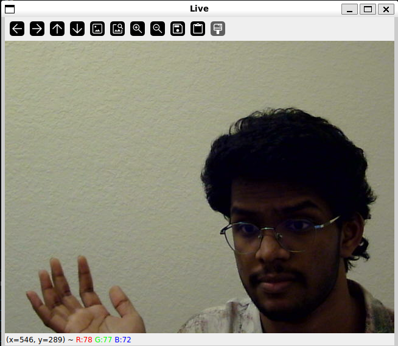

## References

1. [ffmpeg-libav-tutorial](https://github.com/leandromoreira/ffmpeg-libav-tutorial)
   Chapter 0 & 3
2. [encode_video.c](https://ffmpeg.org/doxygen/trunk/encode_video_8c-example.html)
3. [libavcodec API](https://ffmpeg.org/doxygen/trunk/group__libavc.html)
4. [libswscale (BGR → YUV420P)](https://ffmpeg.org/doxygen/trunk/group__libsws.html)
5. [LearnCpp](https://www.learncpp.com/): Enums, Intro to Classes, More on Classes,
   Dynamic Allocation & Move Semantics & Smart Pointers

## FFmpeg-libav-tutorial

video is simply frames running at a certain rate, this is the what it gives the illusion the more fast you run it the smoother it comes out to be!

Codec: software that compresses or decompresses digital video or audio

And to be presice that's why the video stream adn video is same exact, one key frame by the changes only (.mp4 has meta data and etc and has features that help you to skip ahead! and sync with audio) and your h264 can play but it cant skip it simply!

Container: Contains streams provide synchronization and generalt meta data!

- mp4 is a container inside it can hold differnet stream together like h264, aac audio
  Syncing both the stream here smply!

So in that sence we get the raw frames from the camera since they are heavy (one frame is around like for 1 1920*1080 *3 = 6.33Mb for one frame and then per second assuming at 30fps it is around 186.6!) so that why codec is needed point is we get raw frames that are not safe to send because of size and then encode this this takes or does is splits ou thte keyframe packet every 1-2 seconds + packtes adn here every packet is frame and exactly theat
so this is how it works on the decoder side all we goota do is take reverse it take the keyfram and construct the picture and every follwong will rerfernce so contrust based on that keyframe! adn this is how the video works but the.mp4 is container wraps on other streams to give you that sync but the idea is mp4 itselds has the video codec ready to decode it! on the fly!

So mat is converted into the AV Frame (mat to YUY), and then encode this into AVcodec(encoder) -> AVpacket (written to .h264)

Sender: Mat (BGR) → sws_scale → AVFrame (YUV) still raw → encoder → AVPacket

Receiver: AVPacket → decoder → AVFrame (YUV) → sws_scale → Mat (BGR) → cv::imshow

## Encoder

- Why do we need encoder & decoder?

look into the image above simply a raw frame if you try to send directly over the interet (40 seconds at 30fps) it will be around 7.2GB! That's terrible worse! So that's why encoder is needed to reduce the size massively!

## Problems faced

1. Camera turns on in WSL, but frames show up partly green.

The camera sends a frame every 33 ms. Its chunks go through WSL’s slow relay, so only the first part makes it in time and the last chunks get lost. When frame 2 starts, the driver closes the half-filled buffer and moves on to the next buffer.

Fix: ask the camera for MJPEG (compressed in the camera), so each frame is small
enough to fully arrive in time.

Now it works! That's me!

After everyreboot you need to attach the camera back again!
usbipd attach --wsl --busid 2-1

Type this commad to check what it can set or what it can supports simply!
v4l2-ctl -d /dev/video0 --list-formats-ext
So in my the camera driver sends this list that can support the

adn set the Size: Discrete 640x480, formart is MJPG (motion jpeg)

---

Getting into teh encoder stuff from here so the main idea here:
When we get the mat (which is heavy) we need to compress this using the codecs but before that mat needs to change to differnet type YUV420P that encoders needs before that!
So Mat -> Convert -> AV Frame-> encoder ->packets ->.h264 file

Figure out how to convert this mat to the Av frame!

So here the packet is the image squeezed down to H.264 often to 5-kb!
So the packets works something like this have the main keyframe and then what changed! absically! (hand moved, mouth moved)

and each frame coming out is one frame! (Key frame packet or other packet)

Sending the keyframe in live video like (1-2)second is commong so set the keyframe data here as like 1-2 seconds best choice!

Tasks: convert that mat into the AV frame!
