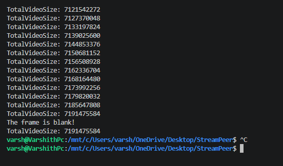
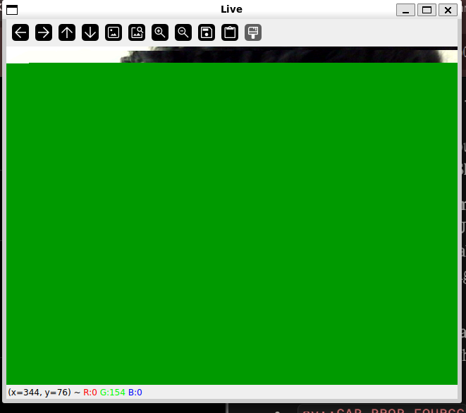

## References

1. [ffmpeg-libav-tutorial](https://github.com/leandromoreira/ffmpeg-libav-tutorial)
   Chapter 0 & 3
2. [encode_video.c](https://ffmpeg.org/doxygen/trunk/encode_video_8c-example.html)
3. [libavcodec API](https://ffmpeg.org/doxygen/trunk/group__libavc.html)
4. [libswscale (BGR → YUV420P)](https://ffmpeg.org/doxygen/trunk/group__libsws.html)

## FFmpeg-libav-tutorial

video is simply frames running at a certain rate, this is the what it gives the illusion the more fast you run it the smoother it comes out to be!

## Encoder

- Why do we need encoder & decoder?

look into the image above simply a raw frame if you try to send directly over the interet (40 seconds at 30fps) it will be around 7.2GB! That's terrible worse! So that's why encoder is needed to reduce the size massively!

## Problems faced

1. Camera turns on in WSL, but frames show up partly green.

The camera sends a frame every 33 ms. Its chunks go through WSL’s slow relay, so only the first part makes it in time and the last chunks get lost. When frame 2 starts, the driver closes the half-filled buffer and moves on to the next buffer.

Fix: ask the camera for MJPEG (compressed in the camera), so each frame is small
enough to fully arrive in time.

Type this commad to check what it can set or what it can supports simply!
v4l2-ctl -d /dev/video0 --list-formats-ext
So in my the camera driver sends this list that can support the

adn set the Size: Discrete 640x480, formart is MJPG (motion jpeg)
